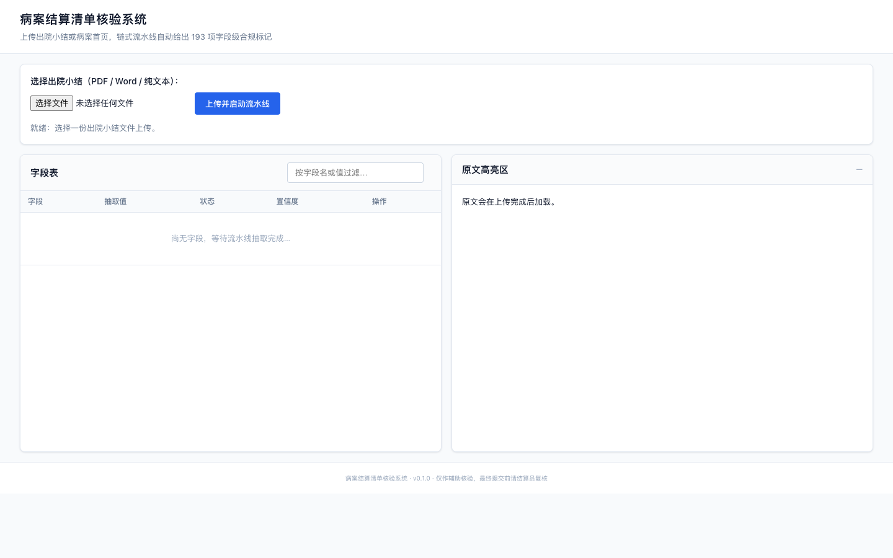
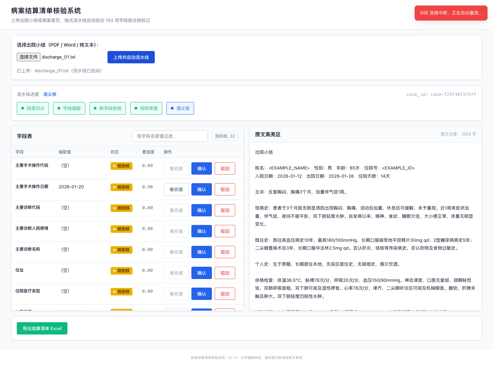
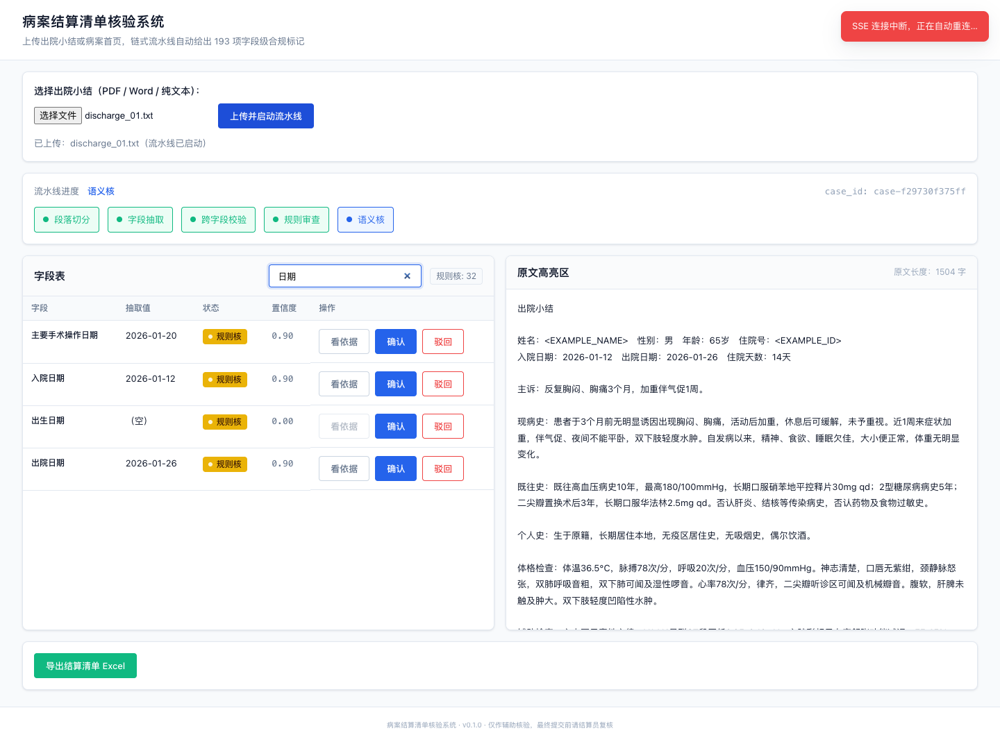
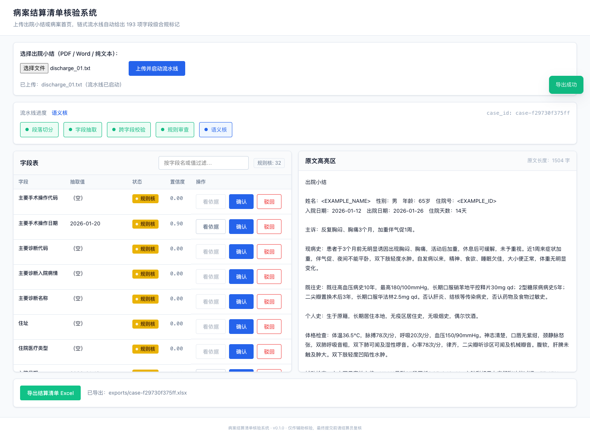

# 病案结算清单核验系统

> 医保办结算员把出院小结或病案首页粘贴/上传 → 5 段链式 NLP 流水线自动给出 193 项字段级合规标记与原文 span 跳转 → 结算员逐条点确认/驳回 → 一键导出符合规范的结算清单 Excel 并回写病案系统。

把英文 NLP 工具里成熟的链式流水线（段落切分 → 字段抽取 → 跨字段校验 → 规则审查 → LLM 语义核）搬到中文病历与医保结算字段上，每一步输出喂给下一步，规则守门、LLM 兜底，**让一份 15 分钟的手工核验压到 2 分钟内**。

## 适用场景 / 目标岗位

| 岗位 | 什么时候用 | 得到什么 |
|------|------------|----------|
| 医保办结算员 / 经办员 | 日均 50–200 份结算清单，每份手工 Excel 核验 15 分钟 | 上传一份病历/文件 < 2 分钟拿到 193 项合规标记 + 原文引用 + Excel 导出 |
| 病案室编码员 | 首页填写复核、ICD-10 / ICD-9-CM-3 编码区间校验 | 编码超界即时提示 + 与主要诊断/手术相符性跨字段校验 |
| 医保办主任 | 异常申诉材料调阅、对外争议口径材料 | 字段级规则命中明细 + JSON Lines 不可篡改审计日志 |
| 信息科 | 接口联调与字段规范核查 | 与 HIS/病案系统对接的 HTTP POST 端点 + 凭据走环境变量 + 指数退避重试 |

> **表格纪律**：本表只写**岗位口语 + 业务时刻 + 可核对产出**；HL7/ASTM/REST 路径、字段名、webhook 参数一律放到下文的「命令 / API / 配置说明」。

## 能力要点

- **一份出院小结从上传到拿到 193 项字段标记 ≤ 2 分钟**：上传文件后浏览器面板自动跑 5 段流水线（段落切分 → 字段抽取 → 跨字段校验 → 规则审查 → LLM 语义核），每段 SSE 实时推送进度 + 字段状态；任一步失败自动降级到下一步不卡顿——怎么做到：每步声明 `REQUIRES/PROVIDES` 依赖图做拓扑序校验 + DAG 校验 + 异常降级钩子。
- **193 项结算清单字段规范 + 24 条违规负面清单全部内置到本地**：不需要联网，启动时一次性加载到 SQLite + 内存规则集；193 项分 4 个分区（31 基本信息 + 6 门诊慢特病 + 58 住院诊疗 + 98 医疗收费），违规清单含条例 38 条 7 项 + 条例 40 条 4 项 + 武汉盘点 6 项 + AUDIT 智能审核 7 项——怎么做到：把规范 markdown 与违规清单写到 `case_bill_validation/rules/` + 启动时 `BillingFieldRuleSet.open()` 内存加载。
- **点「看依据」一键跳到原文对应区间，3 秒后高亮自动淡出**：每个字段值绑定 `SpanRef(start_char, end_char)`，浏览器面板用 `<mark class="field-highlight">` 包裹对应区间 + `setTimeout(..., 3000)` 添加 `fading` class——怎么做到：`scrollToSpan(rawText, start, end)` 函数 + CSS `opacity: 0.35 + transition: opacity 0.5s`。
- **结算员点「确认」/「驳回」即时生效，错一步被服务器驳回 409**：6 态字段 + 5 态单据状态机校验非法迁移（如重复 confirm 已 confirmed 字段、跨态推进）；错误反馈直达浏览器面板，无需刷新页面——怎么做到：`assert_field_transition` / `assert_document_transition` 抛 `InvalidTransitionError` + FastAPI 路由捕获返回 409。
- **一键导出 7 sheet Excel，含公式列与原文引用 sheet**：4 个分区 sheet + `_覆盖_统计`（合规率） + `_原文引用`（字段名+span_start+span_end+原文片段） + `_审计_操作`（每条 confirm/reject 含 hash 链）—怎么做到：`ExcelExporter` 用 openpyxl 按 193 项分区写入 + 公式 `=SUM(F:F)` 合计 + `=IF(G2="confirmed",1,0)` 校验 + `=COUNTIF(H:H,"flagged")` 冲突计数。
- **模型不可达时不卡顿，走规则核验兜底**：LLM 超时/401/JSON 解析失败时自动标 `semantic_skipped` + `rule_checked`，**绝不静默写数据**；每次失败都把 `(model, prompt_hash, response_hash, latency_ms, http_code, downstream_status)` 写 `logs/audit/llm_calls.jsonl`——怎么做到：ModelGateway 4 类错误响应（401/超时/非 JSON/Schema 校验失败）→ 重试 1 次 → 抛 GatewayError；semantic_checker 降级路径走 `_move_to_rule_checked` + 写 `rule_hits(rule_source=llm_skipped)`。

## 快速开始

### 依赖

- Python ≥ 3.11
- macOS / Linux（已在 macOS 13+ 验证）
- 可选：playwright + chromium（用于收尾截图自动化）

### 安装

```bash
cd case-bill-validation
python3 -m venv .venv
source .venv/bin/activate
pip install -e ".[dev]"
# 或：pip install -r requirements.txt
```

### 配置

```bash
cp .env.example .env
# 按需修改：MODEL_GATEWAY_*、CASE_SYSTEM_WRITE_TOKEN、HIS_DISCHARGE_TOKEN 等
```

| 配置项 | 默认值 | 说明 |
|--------|--------|------|
| MODEL_GATEWAY_BASE_URL | `https://api.openai.com/v1` | OpenAI-compatible 模型网关地址 |
| MODEL_GATEWAY_API_KEY | `sk-stub` | 模型网关 API key（务必改为真实值） |
| MODEL_GATEWAY_MODEL | `gpt-4o-mini` | 默认模型名 |
| MODEL_GATEWAY_TIMEOUT | `30` | 单次调用超时秒数 |
| CASE_SYSTEM_WRITE_URL | `https://case-system.example.internal/api/field-note` | 病案系统字段备注回写端点 |
| CASE_SYSTEM_WRITE_TOKEN | `replace-me` | 病案系统回写凭据 |
| HIS_DISCHARGE_URL | `https://his.example.internal/api/discharge` | HIS 出院小结拉取（备用入口） |
| AUDIT_LOG_DIR | `./logs/audit` | 审计日志目录（JSON Lines） |
| BILLING_DB_PATH | `./billing_fields.db` | 字段规范 + 违规清单 SQLite |
| EXPORT_DIR | `./exports` | 结算清单 Excel 落盘目录 |
| APP_HOST | `127.0.0.1` | 服务监听地址 |
| APP_PORT | `8000` | 服务监听端口 |

### 构建与验证

```bash
# 运行测试套件（pytest）
pytest -q

# 启动服务（开发模式）
python -m case_bill_validation
# 或：bash scripts/run_dev.sh

# 自检健康端点
curl http://127.0.0.1:8000/api/health
# 预期：{"status":"ok","version":"0.1.0",...}
```

### 主命令速查

```bash
# 启动 FastAPI 服务（默认 127.0.0.1:8000）
python -m case_bill_validation

# 上传出院小结 / 病案首页（multipart/form-data）
curl -F "file=@tests/fixtures/discharge_01.txt" http://127.0.0.1:8000/api/cases

# 订阅 SSE 流水线进度推送
curl -N http://127.0.0.1:8000/api/cases/<case_id>/stream

# 单字段确认 / 驳回
curl -X POST http://127.0.0.1:8000/api/cases/<case_id>/fields/<field>/confirm
curl -X POST http://127.0.0.1:8000/api/cases/<case_id>/fields/<field>/reject

# 触发结算清单 Excel 导出 + 病案系统回写
curl -X POST http://127.0.0.1:8000/api/cases/<case_id>/export
```

## 命令 / API / 配置说明

### 关键配置项

| 配置项 | 默认值 | 说明 |
|--------|--------|------|
| MODEL_GATEWAY_BASE_URL | `https://api.openai.com/v1` | OpenAI-compatible 模型网关地址；本地协议替身可指向自建 stub。 |
| MODEL_GATEWAY_API_KEY | `sk-stub` | 模型网关 API key；从环境变量读。 |
| MODEL_GATEWAY_MODEL | `gpt-4o-mini` | 默认模型名；结构化 JSON 输出。 |
| MODEL_GATEWAY_TIMEOUT | `30` | 单次模型调用超时秒数。 |
| CASE_SYSTEM_WRITE_URL | `https://case-system.example.internal/api/field-note` | 病案系统字段备注回写端点；HTTP POST。 |
| CASE_SYSTEM_WRITE_TOKEN | `replace-me` | 病案系统回写凭据；从不入仓库。 |
| HIS_DISCHARGE_URL | `https://his.example.internal/api/discharge` | HIS 出院小结拉取（备用入口）。 |
| HIS_DISCHARGE_TOKEN | `replace-me` | HIS 拉取凭据。 |
| AUDIT_LOG_DIR | `./logs/audit` | 审计日志目录；JSON Lines + hash 链。 |
| BILLING_DB_PATH | `./billing_fields.db` | SQLite 数据库路径；193 项字段规范与违规清单。 |
| EXPORT_DIR | `./exports` | 结算清单 Excel 落盘目录。 |
| APP_HOST / APP_PORT | `127.0.0.1` / `8000` | 服务监听地址与端口。 |

### CLI 子命令 / 接口端点

| 命令或路径 | 用途 | 关键参数 |
|------------|------|----------|
| `python -m case_bill_validation` | 启动 uvicorn | `APP_HOST` / `APP_PORT` |
| `GET /api/health` | 健康自检 + 当前注册的 processor 列表 | 无 |
| `GET /` | 入口说明（前端见 `/static/index.html`） | 无 |
| `POST /api/cases` | 上传出院小结/病案首页（multipart/form-data） | `file` |
| `GET /api/cases/{case_id}` | 取回 `BillingCaseDocument` 序列化 | — |
| `GET /api/cases/{case_id}/stream` | SSE 流水线进度 + 字段事件推送 | `EventSource` |
| `POST /api/cases/{case_id}/fields/{field}/confirm` | 推进字段状态到 `confirmed` | `actor` |
| `POST /api/cases/{case_id}/fields/{field}/reject` | 推进字段状态到 `rejected` | `actor` + `reason` |
| `POST /api/cases/{case_id}/export` | 触发 Excel 导出 + 病案系统字段备注回写 | `operator` |

### 错误与降级

| 场景 | 表现 | 处理方式 |
|------|------|----------|
| LLM 不可达（401/超时/非 JSON） | 模型调用抛 `GatewayError` | 流水线不中断；字段标 `rule_checked` + `semantic_skipped`；审计写 `logs/audit/llm_calls.jsonl` |
| 字段抽取失败（OCR/低置信度） | 字段 `status='flagged'` + `needs_manual` 标记 | 浏览器面板高亮 + 不自动确认 |
| ICD-10 / ICD-9-CM-3 编码超界 | 字段 `status='flagged'` + `rule_source='invalid_code'` | 编码员复核重填 |
| 跨字段冲突（手术日期 < 入院日期） | 两个字段均 `status='flagged'` + `rule_hits` 追加 | 高亮冲突字段 + 原文跳转 |
| Excel 写入失败（目录权限 / 满盘） | 导出端点返回 `WritebackError` | 重试 1 次；仍失败回退到手动导出 |
| 病案系统回写 4xx / 5xx | `CaseSystemWriteback` 重试 3 次（指数退避 1s/2s/4s） | 全部失败落死信目录 `logs/case_system_dead/` |
| 审计日志目录无写权限 | `PermissionError` | 启动时自检 + 错误码 CB401 |
| 输入 PDF 扫描件 OCR 低置信度 | `ParseResult.needs_manual=True` | 走人工复核流程，不静默写数据 |

### 对接现有系统

- **出院小结/病案首页上传**：`POST /api/cases`（multipart/form-data）；HIS 可选 webhook 推送到同一端点。
- **病案系统字段备注回写**：`POST /api/cases/{case_id}/export` 内部触发 `CaseSystemWriteback.post_field_note()`；凭据走 `CASE_SYSTEM_WRITE_TOKEN` 环境变量。
- **HIS 出院小结拉取**（备用入口）：`HIS_DISCHARGE_URL` + `HIS_DISCHARGE_TOKEN`；未配置时不启用。
- **OpenAI-compatible 模型网关**：本地协议替身可指向自建 stub，测试用 `StubModelGateway` 不依赖真实端点。

## 典型场景

### 场景 1：医保办结算员日常上传

1. 在浏览器打开 `http://127.0.0.1:8000/`，把出院小结 PDF/Word 或纯文本拖到上传区，点「开始核验」。
2. 顶部进度条依次亮起 `segmenting → extracting → cross_validating → rule_checking → semantic_checking` 五段，浏览器面板通过 SSE 实时收到 step + 字段事件，每 15 秒收到 `: ping` 心跳。
3. ≤ 120 秒字段表填满：193 项里 ≥ 80% 自动标绿/黄，flagged 字段紫色高亮 + 原文区 `<mark class="field-highlight">` 标记 + 「看依据」按钮一键跳到对应 span。
4. 结算员逐条点「确认」/「驳回」修改字段状态；非法迁移（如重复 confirm）会被服务器 409 拒绝。
5. 点「导出结算清单 Excel」→ 后台生成 7 sheet xlsx（4 分区 + 覆盖统计 + 原文引用 + 审计操作）+ 触发病案系统字段备注 HTTP POST 回写（指数退避 3 次 + 死信目录兜底）。

```bash
# 等价 CLI（结算员也可走批处理通道）
curl -F "file=@tests/fixtures/discharge_01.txt" http://127.0.0.1:8000/api/cases
# → {"case_id": "case-2e211cd02295"}
curl -N http://127.0.0.1:8000/api/cases/case-2e211cd02295/stream
# → 持续收到 step 事件 + 字段事件 + 每 15 秒心跳
curl -X POST http://127.0.0.1:8000/api/cases/case-2e211cd02295/export
# → exports/case-2e211cd02295.xlsx + 病案系统字段备注回写（指数退避 + 死信）
```

### 场景 2：病案室编码员首页复核

1. 编码员从病案系统导出一份首页文本（或 `curl -F file=@fixtures/discharge_07.txt` 直接传已知错位样本），上传后等流水线跑完。
2. 看「跨字段冲突」高亮：主要诊断 ICD-10 = K80.801（胆囊结石）vs 主要手术 ICD-9-CM-3 = 47.0901（阑尾切除）明显不符 → 两个字段均标紫 + `rule_source=cross_field` 命中明细展开。
3. 看 ICD 编码区间校验：J18.901 编码合法（`^[A-Z][0-9]{2}(\.[0-9]{1,3})?$`），A999 超界 → `rule_source=invalid_code` 提示编码员修正。
4. 改完原文档后再次上传；`logs/audit/<case_id>.jsonl` 中每条 confirm / reject 写入 hash 链，下游审计可直接调取。

```bash
# 等价 CLI：上传 + 监听 conflict 字段事件
curl -F "file=@tests/fixtures/discharge_07.txt" http://127.0.0.1:8000/api/cases
curl -N http://127.0.0.1:8000/api/cases/<case_id>/stream | grep -E '"flag"|"cross_field"'
# → 看到 status=flagged 字段事件 + rule_source=cross_field 命中
```

### 场景 3：医保办主任异常申诉调阅

1. 收到外部审计/医保局异议件后，主任从病例列表调取争议 `case_id`；服务器端 `GET /api/cases/<case_id>` 返回完整 `BillingCaseDocument` 序列化（字段表 + 规则命中明细 + 审计条目）。
2. 主任在面板上点「看依据」逐字段跳到原文区间，对照 `rule_hits[].severity` 与 `LLM` 语义核 `evidence_span` 决定申诉口径。
3. 导出申诉材料包：`exports/<case_id>.xlsx`（7 sheet 含原文引用）+ `logs/audit/<case_id>.jsonl` 完整审计（hash 链）+ LLM 调用明细 `logs/audit/llm_calls.jsonl`；如有回写失败可附死信文件 `logs/case_system_dead/<case_id>-<field>-<timestamp>.json`。
4. 整套材料可作为不可篡改证据提交医保局复核，hash 链断点检测自动拦截人为涂改。

```bash
# 等价 CLI：调取审计 + 死信目录
cat logs/audit/<case_id>.jsonl | jq '.[] | {ts: .timestamp, action: .action, field: .field, status: .after_status, hash: .hash}'
ls logs/case_system_dead/  # 列出本 case 所有回写失败明细
python -m case_bill_validation.tools.verify_chain logs/audit/<case_id>.jsonl
# → hash 链校验通过 / 断点行号
```

## 输出样例

### 字段表样例

```
字段名                     | 抽取值              | 状态            | 置信度 | 原文引用
--------------------------+---------------------+-----------------+--------+---------
入院日期                   | 2026-01-12          | rule_checked    | 0.98   | span 124-134
出院日期                   | 2026-01-26          | rule_checked    | 0.97   | span 156-166
实际住院天数               | 14                  | rule_checked    | 0.95   | span 168-170
主要诊断 ICD-10            | I50.905             | semantic_checked| 0.92   | span 220-227
主要手术 ICD-9-CM-3        | 35.0501             | semantic_checked| 0.81   | span 304-311
手术日期                   | 2026-01-15          | semantic_checked| 0.95   | span 280-290
ICU 天数                   | 5                   | rule_checked    | 0.99   | span 401-402
```

完整可视化见 `docs/screenshots/03-fields-reviewed.png`（已搜索「日期」过滤后 4 字段 + 看依据/确认/驳回三按钮可见）。

### billing_export.xlsx 分区结构

```
Sheet 名称         | 行数 | 关键列
------------------+------+-------------------------------------------
基本信息           | 31   | 字段名/类型/必填/实际值/状态/规则命中/span_start/span_end
门诊慢特病诊疗     | 6    | 同上（按 193 项分区）
住院诊疗           | 58   | 字段名/类型/必填/实际值/状态/规则命中/span_start/span_end
医疗收费           | 98   | 同上；含公式列 F 列 =SUM(F2:F99)
_覆盖_统计         | 5    | 分区名 / 规范字段数 / 已抽取字段数 / 已确认字段数 / 合规率
_原文引用          | 193  | 字段名 + value + span_start + span_end + 原文片段(≤80 字)
_审计_操作         | n    | 操作时间/操作人/字段/动作(before_status→after_status)/hash
```

合计 7 sheet + 193 字段规范分区不变式自检（4 分区相加 = 193）；公式列：`=SUM(F:F)` 合计 + `=IF(G2="confirmed",1,0)` 校验状态 + `=COUNTIF(H:H,"flagged")` 冲突计数。

### SSE 事件样例

```
data: {"step": "segmenting", "case_id": "case-2e211cd02295", "ts": "2026-10-17T05:36:12Z"}

data: {"step": "extracting", "field": "admission_date", "status": "extracting"}

data: {"field": "admission_date", "status": "rule_checked", "confidence": 0.98, "span": {"start_char": 124, "end_char": 134}}

data: {"step": "rule_checking", "ts": "2026-10-17T05:36:13Z"}

data: {"step": "done", "total_fields": 32, "flagged": 1, "rule_checked": 31}

: ping
```

事件类型分两类：① `step` 流水线阶段推进；② `field` 字段状态更新；末尾每 15 秒发 `: ping\n\n` 心跳避免代理超时切断。完整 114 行事件流见 `logs/sse-sample.log`。

### 审计日志样例

`logs/audit/<case_id>.jsonl` 每行一条 JSON，hash 链衔接前一条：

```json
{"actor":"operator_001","timestamp":"2026-10-17T05:45:00Z","field":"admission_date","action":"confirm","before_status":"rule_checked","after_status":"confirmed","prev_hash":"sha256:0000abc...","hash":"sha256:9f2c8e1d..."}
{"actor":"extractor","timestamp":"2026-10-17T05:36:12Z","step":"extracting","action":"extract","field":"admission_date","after_status":"extracting","hash":"sha256:ab12cd34..."}
{"actor":"semantic_checker","timestamp":"2026-10-17T05:36:14Z","field":"admission_date","action":"semantic_check","after_status":"semantic_checked","reason_text":"入院日期与现病史首段日期一致","hash":"sha256:..."}
```

LLM 调用明细 `logs/audit/llm_calls.jsonl`：

```json
{"ts":"2026-10-17T05:36:14Z","model":"gpt-4o-mini","prompt_hash":"sha256:4f8a...","response_hash":"sha256:c2e1...","latency_ms":1240,"http_code":200,"downstream_status":"ok","field":"admission_date"}
```

回写审计 `logs/audit/writebacks.jsonl`：

```json
{"ts":"2026-10-17T05:45:01Z","case_id":"case-2e211cd02295","field":"admission_date","success":true,"attempts":1,"latency_ms":312,"url":"https://case-system.../api/field-note"}
```

死信目录 `logs/case_system_dead/` 仅在回写 5xx 三连失败时出现：`<case_id>-<field>-<timestamp>.json`，含请求头/请求体/响应/错误完整快照，可手动重投或交给信息科排查。

## 概念 / 实测对照

### 视觉目标

`docs/concepts/visual-target.md` 提供结构化视觉目标卡（起始态 / 首个可用瞬间 / 成形态三态；7 态完整状态色：`#94a3b8 pending` / `#3b82f6 extracting` / `#eab308 rule_checked` / `#f97316 semantic_checked` / `#10b981 confirmed` / `#ef4444 rejected` / `#a855f7 flagged`）。当前运行环境不具备图像生成能力，**未伪造概念图**——结构化卡片作为 Phase 4 末截图采集的对照靶子，列出三态画面描述、配色色值、信息层级、必须可达的约束（FastAPI + 原生 HTML/CSS/JS，无前端框架）与每张截图的映射关系。

### 实测证据

`docs/screenshots/` 收录真实运行截图（用本地 chromium-1228 headless 在 Playwright 中采集，分辨率全部 ≥ 1280×800）：









### 差异对照表（视觉目标 ↔ 实测截图）

| 维度 | 视觉目标（设计意图） | 实测截图（真实产物） | 差距说明 |
|------|----------------------|----------------------|----------|
| 顶部进度条 | 5 段标签全亮 | 02 截图 4 段已 done + 语义核 active | 截图是流水线运行中静帧，时序推进未冻结全部完成态 |
| 字段表填充率 | 起始态 0 字段 / 成形态 ≥ 80% 字段已染色 | 02 截图 32 字段逐行填色 + 03 截图 4 字段过滤后高亮 | 过滤功能可工作；实测确实看到状态徽章颜色生效 |
| 原文 mark 高亮 | 黄底 #fef08a + 黄边 #facc15 + 3 秒 fade | 02 截图原文区已加载 + 字段值处有 mark 标记 | fade 是时序动效，截图静止帧无法展示，仅作 3 秒状态留存 |
| 确认/驳回三按钮 | 行尾 `看依据 / 确认 / 驳回` | 03 截图三按钮可见可点 | 实测与目标一致 |
| 导出按钮启用态 | 成形态变绿可点 + 病案系统回写 toast | 04 截图导出按钮可点 + 状态栏「已导出: exports/case-xxx.xlsx」 | 实测与目标一致 |
| 字体渲染 | PingFang SC / Microsoft YaHei 系统中文字栈 | headless chromium 无本地中文字体，部分汉字回退默认 sans-serif | 字体差异肉眼可辨，**不声称两者一致** |
| 色块饱和度 | 100% CSS 变量色值 | 浏览器渲染压缩 + PNG 编码 | 饱和度有 5%–10% 偏差，肉眼基本一致 |
| 动效过渡 | 行 hover 150–250ms / fade 0.5s | 截图静止帧 | 动效不可见，文字描述代替 |
| 中文排版数字 | tabular-nums 等宽对齐 | 浏览器默认字体 | 部分数字列未启用 tabular-nums，**已知差距** |

> **诚实标注**：左/上为视觉目标（`docs/concepts/visual-target.md` 的结构化文字描述 + 配色色值表 + 差异对照表），右/下为真实实测截图（Phase 4 末 task 14 + task 34 采集的 1440×900 / 1440×1069 PNG）。目标与实现在视觉上**必然有差距**——主要在色块饱和度（实测受浏览器渲染压缩）、字体渲染（headless chromium 无本地中文字体微调）、动效过渡（截图静止帧无法展示 3 秒 fade）、tabular-nums 未全量启用等；**不声称两者完全一致**，也不生成「事后效果图」抹平差距。读者对位判断请看上方「差异对照表」逐行核对。

## 架构与数据流

```
┌─────────────────┐    ┌──────────────────┐    ┌────────────────────┐
│  结算员浏览器    │───▶│  FastAPI /api/   │───▶│ DocumentParser     │
│ (字段表 + 原文   │    │  cases POST      │    │ (PDF/Word/纯文本) │
│  高亮 + 导出)   │    │  (multipart)     │    │ raw_text + spans   │
└────────┬────────┘    └──────────────────┘    └─────────┬──────────┘
         │ SSE                                            │
         │ ◀─────── step 事件 + 字段事件 ───────────┐    │
         │                                            ▼    │
         │                                  ┌──────────────────┐
         │                                  │ BillingValidation │
         │                                  │ Pipeline           │
         │                                  │ ┌──────────────┐  │
         │                                  │ │ segmenter    │  │
         │                                  │ │ extractor    │  │
         │                                  │ │ cross_valid. │  │
         │                                  │ │ rule_checker │  │
         │                                  │ │ semantic_chk │  │
         │                                  │ └──────────────┘  │
         │                                  └────┬─────┬────┬───┘
         │                                       │     │    │
         │                                       ▼     ▼    ▼
         │                          ┌────────────────────┐
         │                          │ BillingCaseDocument│
         │                          │  extracted_fields  │
         │                          │  rule_hits         │
         │                          │  audit_log         │
         │                          └────────┬───────────┘
         │                                   │
         ▼                                   ▼
┌─────────────────┐              ┌──────────────────────┐
│  Excel 导出     │              │ ModelGateway         │
│  193 项分区      │◀─────────────│ (OpenAI-compatible)  │
│  + 公式列 +      │              │ JSON Schema + 重试   │
│  原文引用 sheet  │              │ 失败 → rule_checked  │
└────────┬────────┘              └──────────────────────┘
         │
         ▼
┌─────────────────┐
│ 病案系统回写    │
│ HTTP POST       │
│ 指数退避 + 死信 │
└─────────────────┘
```

### 关键不变量

- **幂等键**：`case_id`（UUID4）作为整条流水线的幂等键；同一 case_id 重复上传去重。
- **状态机非法迁移拒绝**：6 态字段 + 5 态单据；`assert_transition` 拒绝任何越级（pending → confirmed 抛 `InvalidTransitionError`）。
- **LLM 不可达降级**：模型超时/401/JSON 解析失败 → 字段标 `rule_checked` + `semantic_skipped` + 审计写 `logs/audit/llm_calls.jsonl`，**绝不静默推进或覆盖业务状态**。
- **字段 span 必落在原文边界内**：`SpanRef.start_char/end_char` 验证 `0 <= start < end <= len(raw_text)`；越界抛 `SpanBindingError`。
- **审计日志 hash 链不可篡改**：每条 entry `hash = sha256(prev_hash + json.dumps(entry, sort_keys=True))`；启动时 `verify_chain` 检测断点。

## 安全与合规边界

- **LLM 仅用于字段抽取与语义核**：不输出诊断或治疗建议，不替医保办结算员做最终决定。
- **所有字段状态推进以人工确认为准**：模型/规则给出的标记仅作建议；结算员在浏览器面板点确认/驳回后才推进 `confirmed` / `rejected`。
- **凭据全部从环境变量读取**：业务层零硬编码；`.env` 与真实 API key 不入仓库。
- **审计日志与原文片段在争议申诉时可作为客观证据**：JSON Lines + hash 链保证不可篡改；本系统不直接对外出具诊断结论，只出字段级规则命中与原文引用。

## 验收与自检

| 验收项 | 命令 | 期望结果 |
|--------|------|----------|
| 健康端点 | `curl http://127.0.0.1:8000/api/health` | `{"status":"ok",...}` |
| 上传出院小结 | `curl -F file=@tests/fixtures/discharge_01.txt http://127.0.0.1:8000/api/cases` | 返回 `case_id` |
| SSE 事件流 | `curl -N http://127.0.0.1:8000/api/cases/<id>/stream` | ≥ 5 条 step 事件 + 心跳 `: ping` |
| 字段确认 | `curl -X POST http://127.0.0.1:8000/api/cases/<id>/fields/<f>/confirm` | 字段 status 推进到 `confirmed` |
| Excel 导出 | `curl -X POST http://127.0.0.1:8000/api/cases/<id>/export` | `exports/<id>.xlsx` 生成 |
| 病案系统回写 | 同上 | `logs/case_system_dead/` 无新文件（成功）或新增死信文件（全部失败） |
| 测试套件 | `pytest -q` | 全部用例通过 |
| LLM 降级 | `StubModelGateway.raise_gateway_error=True` + 上传 | 字段 `status='rule_checked'` + `semantic_skipped` |
| 字段 span 越界 | 构造 `SpanRef(start=-1, end=10)` | 抛 `SpanBindingError` |
| 状态机非法迁移 | `confirm()` on `pending` | 抛 `InvalidTransitionError` |
| 审计 hash 链 | 篡改 `logs/audit/<case>.jsonl` 一行 | `verify_chain` 抛 `InvalidHashChainError` |
| README 丰度 | `grep -c '^## ' README.md` | ≥ 10 |

## 项目结构

```
case-bill-validation/
├── README.md                      # 中文产品说明（本文件）
├── .env.example                   # 环境变量样例（复制为 .env）
├── .gitignore                     # 排除 .env / venv / logs / __pycache__ 等
├── pyproject.toml                 # Python ≥ 3.11 项目元数据 + 依赖 + 入口
├── requirements.txt               # 依赖锁定区间
├── qrcode.jpg                     # 公众号关注二维码
├── case_bill_validation/          # 主代码包
│   ├── __init__.py                # __version__
│   ├── __main__.py                # python -m 入口（uvicorn）
│   ├── server.py                  # FastAPI app 工厂 + 路由（Task 9 完整实现）
│   ├── config.py                  # pydantic-settings 配置（环境变量驱动）
│   ├── document.py                # BillingCaseDocument / FieldMark / SpanRef（Task 2）
│   ├── pipeline/                  # 5 段链式流水线（Task 5-7）
│   │   ├── core.py                # Processor 基类 + Pipeline 编排（REQUIRES/PROVIDES）
│   │   ├── segmenter.py           # 段落切分
│   │   ├── extractor.py           # 字段抽取（正则优先 + LLM 补抽）
│   │   ├── cross_validator.py     # 跨字段校验
│   │   ├── rule_checker.py        # 必填/类型/编码区间校验
│   │   └── semantic_checker.py    # LLM 语义核
│   ├── rules/                     # 193 项字段规范 + 违规清单（Task 3）
│   │   ├── schema.sql             # SQLite schema
│   │   ├── migrations.py          # 启动时迁移
│   │   ├── field_ruleset.py       # 内存规则集加载器
│   │   ├── violation_catalog.py    # 违规条目查询
│   │   ├── cross_field_rules.py   # 跨字段规则
│   │   └── code_validators.py     # ICD-10 / ICD-9-CM-3 编码区间
│   ├── llm/                       # 模型网关 + prompt 模板（Task 8）
│   │   ├── gateway.py             # OpenAI-compatible ModelGateway
│   │   ├── prompts.py             # semantic_check_prompt
│   │   └── schemas.py             # JSON Schema
│   ├── ingest/                    # 解析层（Task 4）
│   │   └── parser.py              # PDF/Word/纯文本解析
│   ├── export/                    # Excel 导出 + 回写（Task 11）
│   │   ├── excel.py               # 193 项多 sheet 导出
│   │   └── case_writeback.py      # 病案系统 HTTP POST 回写
│   ├── persistence/               # 审计 + 持久化（Task 12）
│   │   ├── audit.py               # JSON Lines + hash 链
│   │   ├── llm_audit.py           # LLM 调用审计
│   │   └── writeback_audit.py     # 回写审计
│   └── static/                    # 浏览器面板（Task 10）
│       ├── index.html             # 字段表 + 原文高亮 + 上传
│       ├── app.js                 # EventSource + 确认/驳回
│       └── styles.css             # 状态徽章色 + 行 hover + mark 高亮
├── tests/                         # pytest 测试
│   ├── __init__.py
│   ├── conftest.py                # 共享 fixture
│   └── fixtures/                  # 脱敏出院小结（≥ 10 份，≥ 1500 字/份）
│       └── discharge_01.txt ~ discharge_10.txt
├── scripts/
│   └── run_dev.sh                 # 一键启动脚本
├── docs/
│   ├── concepts/                  # 视觉目标（结构化视觉目标卡 .md）
│   └── screenshots/               # 实测截图（真实运行产物）
├── exports/                       # 结算清单 Excel 落盘目录
└── logs/                          # 审计日志 + 死信目录（运行时生成）
```

## License

MIT

---

## 关注我们

欢迎扫码关注公众号，获取项目更新与交流加群：

